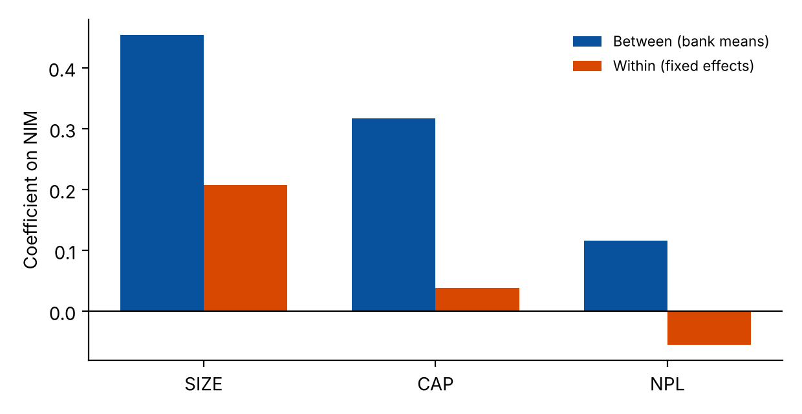

# 02 · Bank NIM, short panel (27 banks, 2018–2023)

Corrected re-estimation of a professional-practicum paper on the determinants of NIM with a size variable (SIZE) and a COVID dummy.

**Panel:** 162 obs. **Regressors:** NPL, SIZE, CAP, INF, GDP, COVID.

## Data
Not included. Needs the practicum workbook (`--data`) and, to back-fill NPL values stored as 0, the panel workbook of project 01 (`--kltn-data`).
```bash
python run.py --data practicum.xlsx --kltn-data ../01-bank-nim-thesis/panel.xlsx --out results
python make_figures.py
```

## Data audit (all affect the original results)
* The COVID text dummy was alphabetically encoded (Có=1, Không=2) and flagged **2019–2022** instead of 2020–2022.
* `SIZE` is log₂(total assets), not ln.
* Some display values were scaled by 100.
* NPL zeros are **missing values** coded as 0; they are replaced from the second workbook (flagged).

## Results (FE, bank-clustered SE)
| Variable | Coef. | p | Comment |
|---|---|---|---|
| NPL | −0.055 | <0.001 | robust in sign, driven by a few banks |
| SIZE | 0.207 | 0.07 | **between** effect 0.454 (p = 0.001) is much larger |
| CAP | 0.038 | 0.72 | **between** effect 0.317 (p = 0.001): capital matters across banks, not within |
| GDP | 0.063 | <0.001 | wild bootstrap by year p = 0.084 |
| COVID | 0.209 | 0.007 | wild bootstrap by year (G = 6) p = 0.014 |

* With T = 6 years only, macro variables have ~2 effective degrees of freedom: Ho–Saunders two-step gives GDP p = 0.39, INF p = 0.49. Treat macro coefficients as descriptive.
* Within-bank variation in SIZE and CAP is small, so FE estimates are imprecise; between-bank estimates are not causal.
* Rolling-origin RMSE: FE 0.72, naive NIM<sub>t−1</sub> 0.55, pooled 2.7.


