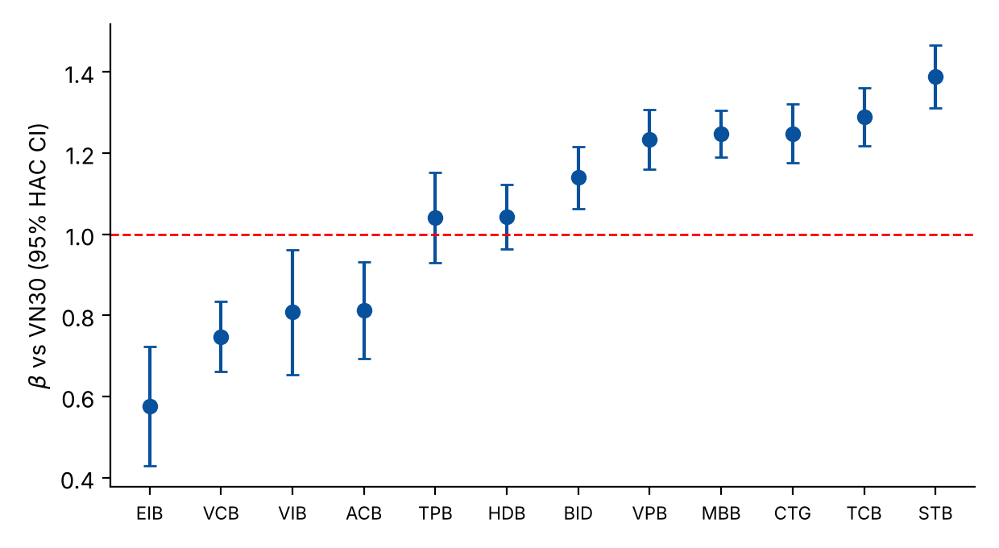

# 03 · Single-index model for 12 Vietnamese bank stocks (2020 – Jul 2024)

Re-estimation of a Sharpe single-index model (SIM) and an Elton–Gruber–Padberg (EGP) optimal portfolio of 12 bank stocks against VN30 (1,134 daily observations).

## Data
Not included (price and return sheets of a workbook: sheet `TSLN` = provided returns, sheet `Giá` = prices). Download daily closing prices for ACB, BID, CTG, EIB, HDB, MBB, STB, TCB, TPB, VCB, VIB, VPB and VN30 from any market-data vendor.
```bash
python run.py --data prices.xlsx --out results && python make_figures.py
```

## The key finding: the "return" series was not a return
The sheet used as the return series equals ln P<sub>t</sub> / ln P<sub>t−1</sub> (a ratio of logs), not ln(P<sub>t</sub>/P<sub>t−1</sub>). Regressing it on the index multiplies each beta by roughly ln P<sub>M</sub> / ln P<sub>i</sub>, so the betas in the original paper were distorted (the code verifies the identity to machine precision and the ratio of the two beta sets).

## Corrected betas (log returns vs VN30, HAC SE)
| Bank | β | R² | Bank | β | R² |
|---|---|---|---|---|---|
| STB | 1.39 | 0.57 | VPB | 1.23 | 0.59 |
| TCB | 1.29 | 0.37 | BID | 1.14 | 0.51 |
| CTG | 1.25 | 0.59 | TPB / HDB | 1.04 | 0.36 / 0.47 |
| MBB | 1.25 | 0.67 | VIB / ACB | 0.81 | 0.21 / 0.31 |
| VCB | 0.75 | 0.36 | EIB | 0.58 | 0.11 |

Eight of twelve betas exceed 1. Dimson and Blume adjustments are in the JSON.

## Is the single-index assumption valid?
No. The residuals are strongly cross-correlated: Breusch–Pagan LM = 996.8 (df = 66, p < 1e−165), mean residual correlation 0.083. A two-index model (VN30 + an orthogonalised sector index) removes most of it (LM falls to 425; mean correlation −0.04) and the sector factor is highly significant for every bank. Betas are also unstable across 2020–21, 2022 and 2023–24 subperiods.

## EGP optimal portfolio (train ≤ 2022, test 2023–24)
Out-of-sample Sharpe: **EGP 0.55**, equal-weight 0.89, VN30 0.98. A block bootstrap of the Sharpe difference (EGP − equal weight) gives a 95% CI of [−1.16, 0.51]: no evidence that optimisation adds value out of sample.


