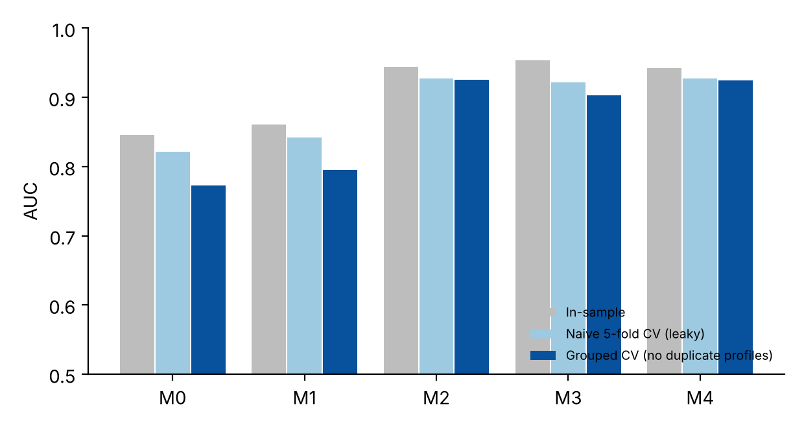

# 04 · Sleep-disorder logit: separation, leakage and what the model really learns

Re-analysis of a categorical-data-analysis paper that fits a logit for sleep disorder on the public *Sleep Health and Lifestyle* dataset (374 rows).

## Data
Public dataset (Kaggle, "Sleep Health and Lifestyle Dataset"); not redistributed here.
```bash
python run.py --data Sleep_health_and_lifestyle_dataset.xlsx --out results && python make_figures.py
```

## Findings
1. **Quasi-complete separation.** The paper's binned logit (duration, quality, stress) has coefficients of magnitude 16–22 and implausible odds ratios; the MLE is not finite. Different software stops at different iterations, so reported estimates differ between packages (a typical symptom of separation).
2. **Duplicate profiles.** The 374 rows contain only **109 distinct full-covariate profiles**, so ordinary k-fold CV leaks identical rows across folds. Grouped CV (GroupKFold on profile) lowers the original model's AUC from 0.82 (naive) to **0.77**.
3. **Omitted variable.** BMI category dominates: adding BMI, age and gender lifts grouped-CV AUC to **0.925**. In that model, sleep duration is not significant (LR p = 0.24) whereas BMI is (LR = 73, p ≈ 1e−17) and stress is (p = 1.5e−4).
4. **Firth penalised logit** gives a finite odds ratio for overweight/obese ≈ 64 (95% CI 20–204). Average marginal effects: +55 pp (overweight) and +61 pp (obese) in sleep-disorder probability.
5. **Cluster-robust inference by profile** is used for p-values since duplicated rows are not independent. Multinomial (none / insomnia / apnea) accuracy is 91%.

| Model | In-sample AUC | Naive CV | Grouped CV |
|---|---|---|---|
| M0 paper spec | 0.846 | 0.821 | 0.772 |
| M1 numeric duration + stress | 0.860 | 0.843 | 0.795 |
| M2 + age, BMI, gender | 0.944 | 0.927 | 0.925 |
| M3 + occupation | 0.953 | 0.921 | 0.903 |
| M4 M2 + sleep quality | 0.942 | 0.927 | 0.925 |

**Caveat:** the dataset is small with many duplicated rows; the result is about methodology (separation, leakage), not clinical inference.


